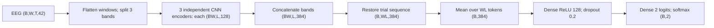
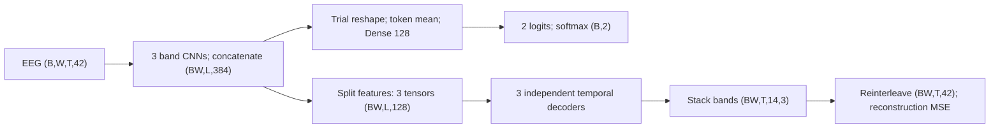
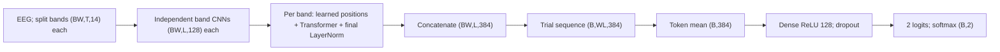
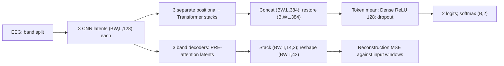

# SIC v16: four model architectures and dimension calculations

Prepared for manuscript methods and figure development. Scope: the four current campaigns in `experiments/sic_v16/first4/` (also used by the original all23 campaigns). These are implementation diagrams, not claims of predictive validity. Dimensions follow the campaign defaults; changed search-run settings must be reported separately.

## Notation and shared encoder

B = trials per batch, W = windows per trial, T = samples per window, N = BW flattened windows, E = 128 embedding features per band, K = 2 classes. Let q be the product of temporal pooling factors and L = ceil(T/q). Current campaigns have no temporal pooling, so q = 1 and L = T. A numerical example below uses T = 128; W remains explicit because it depends on windowing.

Input X has shape (B,W,T,42). Flatten only batch and window axes to (N,T,42). Feature index 3c+b represents electrode c and band b. Reshape to (N,T,14,3) and select theta, alpha, beta separately. Three independently parameterized encoders each receive (N,T,14). Bands are not summed in v16: each underlying CNN has n_bands=1.

For each band, the fixed electrode placement matrix P has shape (14,81), with one unit entry per electrode and zeros elsewhere. G[n,t,:,:] = reshape(X_band[n,t,:] P,9,9). Empty scalp positions are zero. Add a singleton feature axis to obtain (N,T,9,9,1).

| Per-band operation | Output shape | At T=128 |
| --- | --- | --- |
| Scalp placement | (N,T,9,9,1) | (N,128,9,9,1) |
| Conv3D, 32 filters, kernel (7,3,3), stride 1, SAME; LayerNorm, ReLU | (N,T,9,9,32) | (N,128,9,9,32) |
| MaxPool3D (1,2,2), SAME; SpatialDropout3D 0.2 | (N,T,5,5,32) | (N,128,5,5,32) |
| Conv3D, 64 filters, kernel (7,3,3), stride 1, SAME; LayerNorm, ReLU | (N,T,5,5,64) | (N,128,5,5,64) |
| MaxPool3D (1,2,2), SAME; SpatialDropout3D 0.2 | (N,T,3,3,64) | (N,128,3,3,64) |
| Mean over two scalp axes | (N,T,64) | (N,128,64) |
| Optional temporal SAME pooling | (N,L,64) | (N,128,64) |
| Conv1D kernel 1, 128 outputs, linear | (N,L,128) | (N,128,128) |

SAME convolution output length is ceil(input/stride). SAME pooling gives 9 -> ceil(9/2)=5 -> ceil(5/2)=3, not 9 -> 4 -> 2. Spatial averaging gives 64 features, not 3*3*64=576. The pointwise projection has weight shape (1,64,128) and bias shape (128). LayerNorm operates on the final feature axis; it does not alter dimensions.

## 1. CNN (`cnn`)

Concatenation is along features: 3E=384. Restoring trials merges the window and within-window token axes, never the trial axis. For q=1, the classifier sequence is (B,WT,384). The dense classifier weights are (384,128), then (128,2). This yields one prediction per trial.

## 2. CNN with reconstruction (`cnn_reconstruction`)

Each decoder consumes its own band's CNN latent. With no temporal pooling, it is simply a linear Conv1D(kernel=1, filters=14): (N,T,128) -> (N,T,14), weights (1,128,14), bias (14). It is not a mirrored Conv3D spatial decoder. If temporal pooling is enabled, reverse-factor UpSampling1D stages each precede Conv1D(kernel=3, filters=128), activation and dropout; final projection is cropped/padded to T.

Stacking, rather than concatenating band outputs, restores channel-major/band-minor order: (N,T,14) x 3 -> (N,T,14,3) -> (N,T,42).

## 3. CNN with Transformer (`cnn_transformer`)

Attention operates separately inside each band and window, over L tokens. It does not attend across windows or across bands. Concatenation and trial averaging follow attention.

For each band Z in R^(N x L x 128), add learned positions A in R^(L x 128). One pre-normalized block (campaign default) computes:

$$U=Z+\operatorname{Dropout}(\operatorname{MHA}(\operatorname{LN}(Z))),$$
$$V=U+\operatorname{Dropout}(W_2\operatorname{Dropout}(\operatorname{GELU}(W_1\operatorname{LN}(U)+b_1))+b_2).$$

Here Z includes the positional addition. Four heads each use d_k=128/4=32. Q,K,V per head have shape (N,L,32); attention scores QK^T/sqrt(32) have shape (N,4,L,L). Softmax-weighted values recombine to (N,L,128). The feed-forward expansion is (N,L,128) -> (N,L,256) -> (N,L,128), so both residual additions are dimensionally valid. A final LayerNorm preserves shape. At T=128 and no temporal pooling, attention scores are (BW,4,128,128) per band.

## 4. CNN with Transformer and reconstruction (`cnn_transformer_reconstruction`)

The reconstruction fork is before positional embeddings and attention. Reconstruction gradients therefore train the CNN and decoder directly; the reconstruction path does not pass through the Transformer. Classification gradients train both CNN and Transformer.

## Objectives and variant comparison

For predicted trial probability p and target y, ordinary unsmoothed cross entropy is -log p_y. The implementation can apply configured class/sample weighting and label smoothing; focal_gamma=0 in current campaigns removes the focal modulation. The reconstruction objective is

$$\mathcal L_{rec}=\frac{1}{3NT14}\sum_{b=1}^3\sum_{n,t,c}(X_{ntcb}-\widehat X_{ntcb})^2.$$

This is exactly the mean of three per-band MSEs, also equal to MSE over the reinterleaved 42 features. Default source training uses classification weight 1 and reconstruction weight 0.1 when enabled.

| Campaign | Attention | Reconstruction | Default source objective |
| --- | --- | --- | --- |
| cnn | No | No | classification |
| cnn_reconstruction | No | Yes | classification + 0.1 reconstruction |
| cnn_transformer | Per band/window | No | classification |
| cnn_transformer_reconstruction | Per band/window | Pre-attention | classification + 0.1 reconstruction |

Current campaigns disable recurrent classification, the variational head, and subject adversarial training. Compatibility names graph_encoder and gcn_gru_decoder in SIC's shared interface refer to the three-band CNN and decoder here; these variants contain no graph convolution or spectral GRU. Reconstruction is an auxiliary training path; inference uses the classification path.

## Source and verification record

- [v16 model, band split, feature fork, classifier and reconstruction](../../src/eegproc/deep_learning/joint_architectures/SICModelv16/sic_model.py)
- [Conv3D grid encoder and temporal decoder](../../src/eegproc/deep_learning/unsupervised/Convolutions/CNN3D.py)
- [Transformer implementation](../../src/eegproc/deep_learning/supervised/cnn_transformer.py) (the standalone classifier builder in this file is distinct from the three-band v16 model)
- [Shared trial reshaping and probability outputs](../../src/eegproc/deep_learning/joint_architectures/sic_common/model.py)
- [Current campaign definitions](../../experiments/sic_v16/first4/)

Shapes and branches were checked against source and campaign JSON on 2026-11-01. TensorFlow is unavailable in this local Python environment, so no forward-pass or training verification was performed for this documentation change. T=128 is an illustrative input, not an assertion that every run uses that window length. These diagrams do not establish accuracy, generalization, or publication readiness of results. Mermaid blocks are editable diagram sources and render in Mermaid-capable Markdown viewers.
