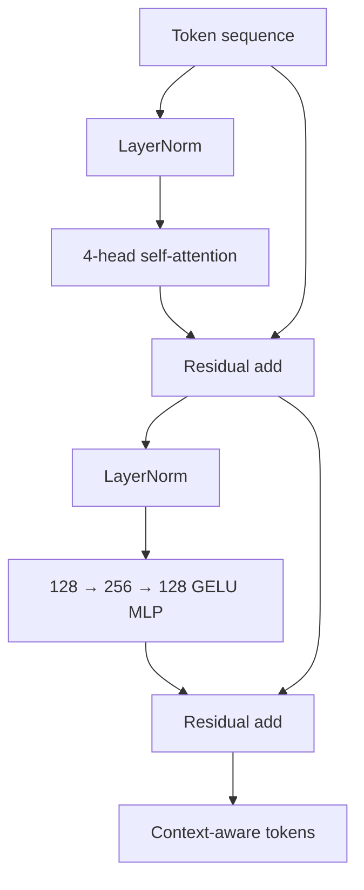

# Standalone DREAMER 3D-CNN + Transformer

## Design summary

This model is deliberately separate from SIC. It is a supervised binary
classifier whose only learned path is a two-block 3D CNN, a temporal
Transformer encoder, and a small classification head. It keeps the original
DREAMER electrode-grid projection and LOSO evaluation pipeline so comparisons
with the earlier 3D-CNN baseline remain meaningful. The default configuration
has 305,442 trainable and non-trainable parameters in total.

```mermaid
flowchart LR
    A["EEG window<br/>128 × 42"] --> B["Sum theta/alpha/beta<br/>per electrode"]
    B --> C["9 × 9 scalp grid sequence<br/>128 × 9 × 9 × 1"]
    C --> D["Conv3D block 1<br/>32 filters + 2 × 2 spatial pool"]
    D --> E["Conv3D block 2<br/>64 filters + 2 × 2 spatial pool"]
    E --> F["Average scalp axes<br/>128 local feature vectors"]
    F --> G["1 × 1 projection +<br/>learned time positions<br/>128 tokens × 128 dims"]
    G --> H["Temporal Transformer<br/>4-head self-attention + MLP"]
    H --> I["Average tokens"]
    I --> J["128-unit GELU head"]
    J --> K["Valence or arousal<br/>2-class probabilities"]
```

## Tensor path and learning role

| Stage | Default output | Intended learning role |
|---|---:|---|
| Window normalization | `128 × 42` | Put each feature on a comparable scale without fitting statistics on held-out subjects. |
| Band-to-electrode reconstruction | `128 × 14` | Reconstruct the same raw-like 4–30 Hz channel signal used by the prior 3D CNN. |
| Electrode-grid projection | `128 × 9 × 9 × 1` | Encode known sensor geometry rather than asking the network to rediscover channel positions. |
| Conv3D block 1 | `128 × 5 × 5 × 32` | Learn short, local motifs: waveform edges, neighboring-electrode co-activation, and compact scalp patterns. |
| Conv3D block 2 | `128 × 3 × 3 × 64` | Combine those motifs into wider regional spatiotemporal features. This is the final convolutional block; the previous third block is removed. |
| Spatial mean + projection | `128 × 128` | Turn each time point into one compact token while retaining the full temporal order. |
| Learned positional embedding | `128 × 128` | Tell attention where each token occurs, because self-attention alone is order-agnostic. |
| Four-head self-attention | `128 × 128` | Let each moment retrieve relevant context from every other moment. Different heads can specialize in distinct temporal relationships. |
| Feed-forward sublayer | `128 × 128` | Nonlinearly refine each context-enriched token. Residual paths and pre-layer normalization stabilize training. |
| Temporal average | `128` | Summarize evidence across the window without privileging a special classification token. |
| Dense classifier | `2` | Convert the global representation into class probabilities for one target at a time. |

The two Conv3D kernels are `7 × 3 × 3`: seven samples in time and a local
three-by-three scalp neighborhood. Pooling is spatial only, so attention still
receives all 128 time positions. This split gives the CNN a strong locality and
electrode-geometry bias while assigning long-range temporal integration to the
Transformer.

## Why this version is intentionally small

DREAMER has only 23 subjects. One Transformer block, 128-dimensional tokens,
four attention heads, dropout, weight decay, early stopping, and subject-wise
LOSO validation are conservative defaults intended to reduce overfitting. The
campaign tests optimizer and regularization choices before adding a second
Transformer block or increasing representation size. The required two-CNN-
block constraint is enforced by the model builder, so an invalid three-block
configuration fails immediately.

## Literature informing the design

- [TransBTS](https://arxiv.org/abs/2103.04430) demonstrates the general local-
  then-global pattern: a 3D CNN forms local volumetric features, which are
  converted to tokens for Transformer-based global modeling.
- [CIT-EmotionNet](https://arxiv.org/abs/2305.05548) motivates combining CNN
  locality with Transformer global context specifically for EEG emotion
  recognition.
- [EmT](https://doi.org/10.1109/TNNLS.2025.3552603) emphasizes temporal
  contextual modeling for generalized cross-subject EEG emotion recognition.
- [ViViT](https://openaccess.thecvf.com/content/ICCV2021/html/Arnab_ViViT_A_Video_Vision_Transformer_ICCV_2021_paper.html)
  highlights the computational and statistical cost of long spatiotemporal
  token sequences. Here the CNN collapses the two scalp axes before attention,
  leaving only 128 temporal tokens.

This implementation borrows the architectural principles, not task-specific
layers or reported hyperparameters. Its performance must be established by the
tracked DREAMER LOSO runs.
